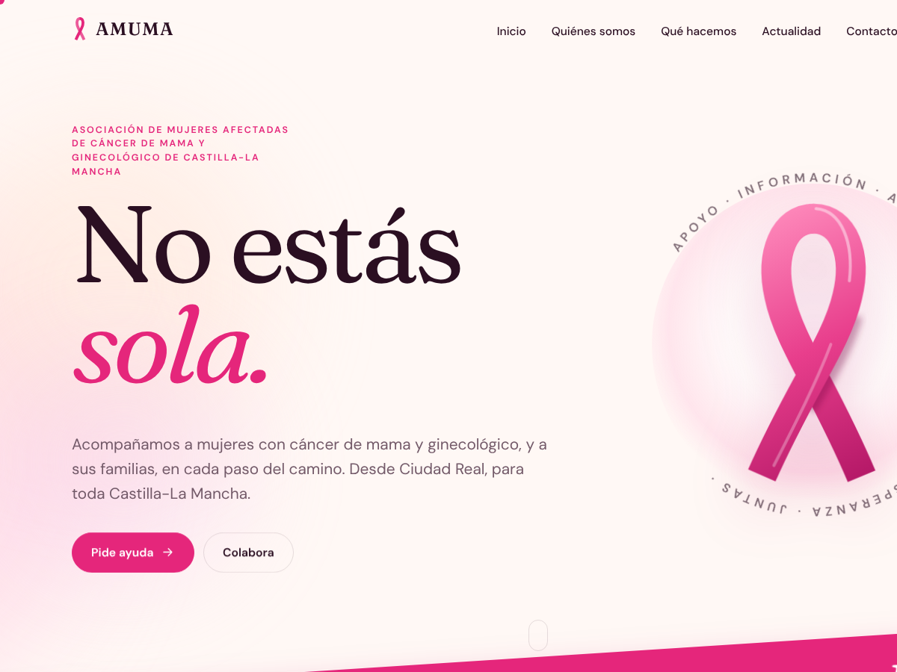

# AMUMA · tema de WordPress

Tema a medida para **AMUMA**, Asociación de Cáncer de Mama y Ginecológico de Castilla-La Mancha, con sede en Ciudad Real (Ronda de Calatrava 18).

El lazo rosa es el protagonista: se dibuja solo al entrar, flota, gira al hacer scroll y aparece en el menú, en las tarjetas y en el pie. Los textos aparecen letra a letra y la cinta rosa de palabras se acelera al bajar por la página. Las noticias de la portada se recorren en horizontal y las fotos se abren a pantalla completa.



---

## 1. Cambiar amuma.org a este tema (paso a paso)

La web actual usa **Divi**. El tema nuevo trae un "traductor" de Divi: las 133 noticias antiguas (con sus `[et_pb_…]`, galerías e imágenes) se ven limpias, con la galería en mosaico y el visor de fotos, **sin tocar la base de datos**. Si algo fuera mal, basta con volver a activar Divi y todo queda como estaba.

1. **Copia de seguridad**: ya tenéis *All-in-One WP Migration* instalado → Exportar → Archivo.
2. Descarga `amuma.zip` (GitHub → **Actions** → "Empaquetar tema" → artefacto **amuma-tema**, o `./tools/build-zip.sh`).
3. **Apariencia → Temas → Añadir nuevo → Subir tema** → `amuma.zip` → **Activar**.
4. Si el plugin *Divi Builder* estuviera activo, desactívalo (el tema solo traduce Divi cuando Divi no está).
5. Revisa la portada, una noticia antigua con galería y las páginas. Listo.

Al activarse, el tema hace estos ajustes **una sola vez**:

| Antes | Después |
|---|---|
| Categoría "Publicaciones" | **Noticias** (URL `/category/noticias/`) |
| Categoría "Acttividades" (con errata) | **Actividades** (URL `/category/actividades/`) |
| Página "Blog" (módulo de Divi) | Listado automático de noticias, titulado **Noticias y actividades** (sigue en `/blog/`) |

Las páginas **Asociación, Servicios, Hazte socio, Actividades y Contacto** tienen diseño propio y su contenido ya está metido en el tema (textos de amuma.org). Las **páginas legales** (aviso legal, privacidad, cookies) se muestran con su texto actual.

## 2. Qué se edita y dónde

| Qué | Dónde |
|---|---|
| **Noticias y actividades** | Entradas (ver punto 3) |
| Portada: titular, botones, cifras, "Súmate al lazo" | Apariencia → Personalizar → **AMUMA** |
| Dirección, teléfonos, email, horario, redes | Apariencia → Personalizar → AMUMA → **Contacto y redes** |
| Junta directiva, servicios, cuotas e IBAN, misión, actividades fijas | `amuma/inc/content.php` (un solo archivo, ordenado por páginas) |
| Logo | Ya va el de AMUMA. Para cambiarlo: Personalizar → Identidad del sitio → Logo |
| Menú | Por defecto: Inicio · Asociación · Servicios · Noticias · Actividades · Contacto (+ botón "Hazte socia"). Si creas uno en Apariencia → Menús y lo asignas a "Menú principal", manda el tuyo. |

**Formularios**: el de contacto y el de alta de socia están en el tema (los de Divi desaparecen al cambiar). Llegan a `info@amuma.org`. Recomendado instalar **WP Mail SMTP** para que no acaben en spam. Llevan protección antispam sin captcha. También se pueden poner en cualquier página con `[amuma_contacto]` o `[amuma_socio]`.

**Mapa**: OpenStreetMap, que no usa cookies, así que no necesita aviso de cookies.

⚠️ **Revisar con la asociación**:
- El **aviso legal** antiguo dice "Calle Calatrava 3, 13001", cuando la sede actual es Ronda de Calatrava 18, 13003. Conviene actualizarlo (Páginas → Aviso legal).
- El **horario** (lunes a viernes, de 9 a 13 h) sale del cartel de *Tejiendo por la vida*. Hay que confirmarlo.
- La página **Actividades** antigua tenía eventos de 2022-2023. El diseño nuevo muestra las actividades fijas, el proyecto *Tejiendo por la vida* (con su vídeo) y las últimas noticias, que se actualizan solas.

## 3. Publicar una noticia o actividad (lo que harán cada mes)

1. **Entradas → Añadir nueva**.
2. Escribe el **título** y el texto.
3. Para las fotos, añade un bloque **Galería** (botón `+` → Galería) y selecciona todas las fotos de una vez. El tema las monta en mosaico y se abren a pantalla completa al pulsarlas, con flechas y deslizando el dedo en el móvil.
4. A la derecha:
   - **Categoría**: *Noticias* o *Actividades*.
   - **Imagen destacada**: la foto de portada. Es opcional: si no la ponen, el tema usa la primera foto de la noticia.
   - **Extracto** (opcional): frase corta que sale bajo el título.
5. **Publicar**.

No hay que tocar nada más: la noticia aparece en el carrusel de la portada, en *Actualidad* (con filtros por categoría y botón "Ver más") y en "También te puede interesar".

**Consejo**: subid las fotos a un tamaño razonable (unos 2000 px de lado como máximo). WordPress crea solo los tamaños más pequeños.

## 4. Qué incluye

- **Portada**: intro con el lazo dibujándose (solo la primera vez por visita), titular animado, lazo 3D que sigue al ratón, cinta de palabras que reacciona al scroll, "Quiénes somos" con el texto que se ilumina al leer, cifras con contador, servicios con efecto de inclinación, **Actualidad en carrusel horizontal**, "Súmate al lazo" y contacto.
- **Actualidad** (listado): noticia destacada grande, rejilla tipo revista, filtros *Todo / Actividades / Noticias* y "Ver más" sin recargar la página.
- **Noticia**: cabecera grande, foto que se abre al entrar, galería en mosaico con visor a pantalla completa, botones para compartir (WhatsApp, Facebook, X, copiar enlace), anterior/siguiente y relacionadas.
- **Páginas** (Quiénes somos, Contacto, Aviso legal…) con el mismo estilo.
- **Accesibilidad**: si el sistema pide reducir el movimiento, la web se ve sin animaciones. Si el JavaScript falla, el contenido se muestra igualmente.
- **Rendimiento y RGPD**: fuentes (Fraunces y DM Sans) y librerías (GSAP, Lenis) incluidas en el propio tema, sin Google Fonts ni CDNs externos.
- Compatible con las galerías antiguas (`[gallery]`) de las noticias ya publicadas.

## 5. Estructura

```
amuma/                     ← el tema (esta carpeta es la que va en el .zip)
├── style.css              ← cabecera del tema
├── functions.php          ← configuración, scripts, categorías al activar
├── inc/customizer.php     ← textos editables (Apariencia → Personalizar → AMUMA)
├── inc/template-tags.php  ← funciones de apoyo (imagen automática, iconos, menú…)
├── inc/content.php        ← textos de Asociación, Servicios, Hazte socio, Actividades, Contacto
├── inc/divi-compat.php    ← traduce el contenido antiguo de Divi
├── inc/forms.php          ← formularios de contacto y alta de socia
├── page-asociacion.php, page-servicios.php, page-hazte-socio.php,
│   page-actividades.php, page-contacto.php   ← páginas con diseño propio (por su URL)
├── front-page.php         ← portada
├── home.php / archive.php / search.php → template-parts/listing.php   ← Actualidad
├── single.php             ← noticia
├── page.php, 404.php
├── template-parts/        ← tarjeta de noticia, lazo SVG, listado
└── assets/
    ├── css/main.css       ← todos los estilos (colores en :root)
    ├── js/main.js         ← animaciones e interacción
    ├── fonts/  vendor/    ← fuentes y librerías incluidas
tools/build-zip.sh         ← genera amuma.zip
```

Colores principales (en `assets/css/main.css`, bloque `:root`): rosa `#e5267b`, ciruela `#2b0f22`, crema `#fff8f5`.

## Licencias

Tema GPL-2.0-or-later. GSAP (licencia estándar gratuita de GSAP), Lenis (MIT), Fraunces y DM Sans (SIL Open Font License).
